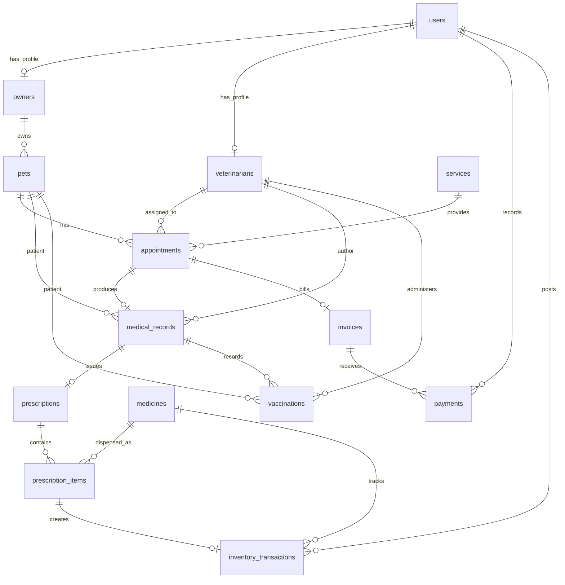

# Veterinary database



| Table | Main fields and relationships |
| --- | --- |
| users | Name, unique email, hashed password, role (`admin`, `veterinarian`, `owner`), active flag; existing verification, passkey and two-factor fields |
| owners | Unique user_id, phone, address; one owner has many pets |
| veterinarians | Unique user_id, unique nullable license_number, specialization; one veterinarian has many appointments |
| pets | owner_id, name, species, breed, sex, birth_date, weight (kg), color; existing allergy/notes field retained |
| appointments | pet_id, veterinarian_id, appointment_date (date and time), reason, status; service_id, service_name and service_fee retained for billing |
| medical_records | Unique appointment_id, pet_id, veterinarian_id, symptoms, diagnosis, treatment, notes; one record per completed visit |
| prescriptions | Unique medical_record_id, instructions |
| prescription_items | prescription_id, medicine_id, prescribed quantity, dispensed_quantity, dosage, medicine_name, medicine_unit and unit_price snapshots; medicine unique within each prescription |
| vaccinations | pet_id, veterinarian_id, vaccine_name, date_given, next_due_date; medical_record_id and batch_number retained for clinical history |
| medicines | Name/batch, unit, quantity, unit_price, reorder_level, expires_at, active |
| services | Name, description, price, active |
| invoices | Unique appointment_id, service_amount, medicine_amount, total, due_date |
| payments | invoice_id, recorded_by user_id, amount, method, reference, paid_at, nullable request_key; (invoice_id, request_key) unique for retry protection |
| inventory_transactions | medicine_id, user_id, optional unique prescription_item_id, signed quantity_change, balance_after, type, notes |
| clinic_settings | Clinic name, phone and address |

All domain tables include primary IDs and timestamps. Foreign keys preserve history. Owners, veterinarians, services, medicines and invoices use separate IDs; a user ID is never assumed to be a profile ID in the application.

## Requested patient and clinical fields

The five core tables contain the requested columns:

```text
owners: id, user_id, phone, address
pets: id, owner_id, name, species, breed, sex, birth_date, weight, color
appointments: id, pet_id, veterinarian_id, appointment_date, reason, status
medical_records: id, appointment_id, pet_id, veterinarian_id, symptoms, diagnosis, treatment, notes
vaccinations: id, pet_id, veterinarian_id, vaccine_name, date_given, next_due_date
```

Weight is optional, stored as DECIMAL(8,2) in kilograms, and accepts positive values with up to two decimal places. Color is an optional string. Existing pets have null weight/color until those details are entered. Clinical notes and the next vaccination due date are optional.

The fifth migration renames scheduled_at to appointment_date, examination to symptoms, and the vaccination fields vaccine/administered_at/next_due_at to vaccine_name/date_given/next_due_date. Existing values are retained. It backfills medical-record and vaccination pet/veterinarian IDs from the linked appointment before enforcing their foreign keys. New clinical writes derive those IDs from the appointment and medical record, preventing a submitted ID from attaching a record to a different patient or clinician.

Appointments retain time as well as date for scheduling conflicts. Existing service, prescription, billing, stock and audit fields remain available alongside these core fields.

An owner can register many pets. Each pet can have many appointments, and each appointment has one assigned veterinarian and one service. A confirmed appointment can produce one medical record, which may have a prescription with multiple medicine items and multiple vaccination records. The examination form supports multiple vaccines with individual administration and follow-up dates. Completion creates one invoice, which may receive multiple partial payments.

Veterinarians read prior records for patients assigned to them, including records written by another veterinarian. Changes to appointments and new examinations remain restricted to the assigned veterinarian. A cancelled assignment alone does not grant access to the patient's clinical history. Owners only read their own pets' records and invoices.

Pending appointments can be confirmed or cancelled. Confirmed appointments can be cancelled or completed by their assigned veterinarian through the examination form. Completed and cancelled appointments are closed. Pet owners can cancel their own future visits; staff handle past visits.

Open visits can be rescheduled or assigned to another active veterinarian by an admin, or by the owning customer while the original visit is still in the future. Changed appointments return to pending confirmation. Booking conflict checks apply again, excluding the appointment being edited; booked service fees and labels are retained.

Prescribed quantities and quantities supplied by the clinic are separate. A prescription-only item has dispensed_quantity = 0, creates no stock transaction, and adds no medicine charge. Supplied items deduct stock, generate a linked inventory transaction, and contribute to the invoice. Earlier versions always dispensed all prescription items; migration preserves that historical behavior.

Role changes keep old profiles in place to preserve history. Directories and booking choices use the account's current role. Last-admin protection and checks for open veterinary appointments prevent account changes that would leave the clinic without administration or visits without an active clinician.

Writes that complete a visit, dispense stock, generate an invoice, record a payment, or adjust stock use database transactions. MySQL row locks serialize competing bookings, stock changes and payments. SQLite supports the development/test workflow with database-level write locking.

Owner phone/address fields are editable by the owner at registration and through account settings, as well as by administrators. Optional blank contact values are stored as null. Self-service updates derive the profile from the authenticated account; changing to a staff role does not grant self-service writes to a retained historical owner profile.
